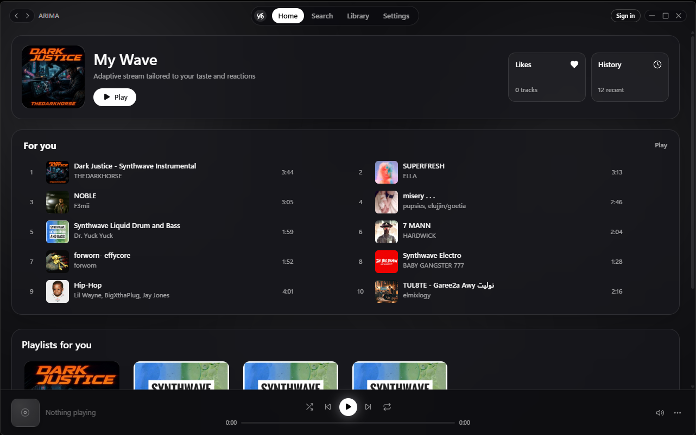
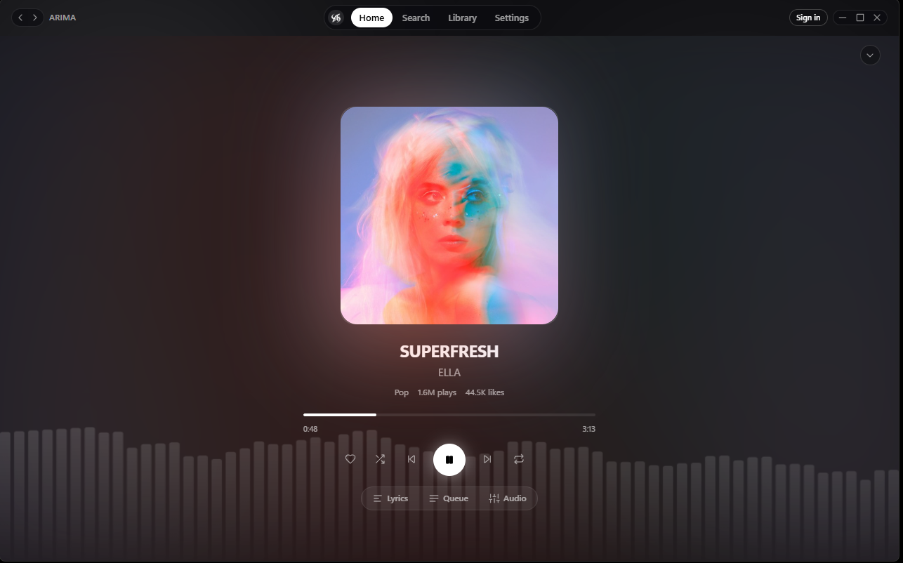
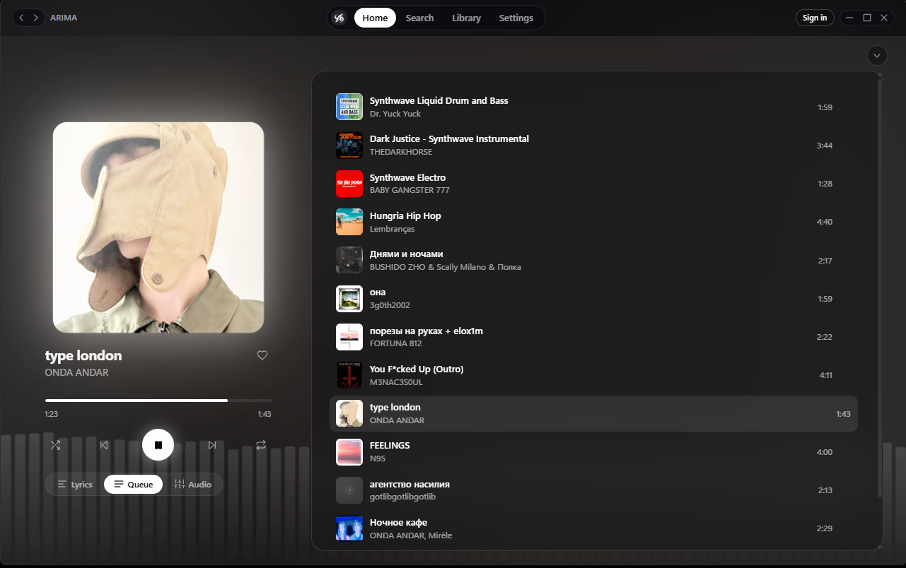

<p>
  
</p>

# Arima

SoundCloud desktop client for Windows in a single portable executable.

<p>
  <a href="https://github.com/nyawkdev/Arima/releases/latest">
    
  </a>
  
  
</p>

[Website](https://nyawkdev.github.io/Arima/) / [Download Arima.exe](https://github.com/nyawkdev/Arima/releases/latest) / [Issues](https://github.com/nyawkdev/Arima/issues)



<table>
  <tr>
    <td width="50%">
      
    </td>
    <td width="50%">
      
    </td>
  </tr>
</table>

## Features

- Dark, light, and system themes with preset color palettes, custom colors, and cover-based theme colors
- Floating mini-player overlay (Island, Pill, Mini) with fullscreen auto-hide and `Ctrl+Alt+I` hotkey
- 5-band equalizer, preamp, Bass Boost, and playback modes (Slowed, Slowed + Reverb, Speed Up, Nightcore)
- Synced lyrics viewer with click-to-seek
- Windows media controls (SMTC) with cover art and Discord Rich Presence
- Local listening history, stream cache, proxy support, and single portable `Arima.exe`

## Download

Download `Arima.exe` from [Releases](https://github.com/nyawkdev/Arima/releases/latest) or the [project site](https://nyawkdev.github.io/Arima/). Requires Windows 10/11 (x64) with WebView2 Runtime, no installer needed.

## Build from source

```bash
npm install
npm run check
npm run lint:design
npm run tauri dev
```

Portable Windows build:

```bash
npx tauri build --no-bundle
```

The output binary is written to `src-tauri/target/release/arima.exe`.

## Data and reset

| Data | Location |
| --- | --- |
| Settings and SQLite DB | `%APPDATA%\app.arima.desktop` |
| Audio and WebView cache | `%LOCALAPPDATA%\app.arima.desktop` |
| SoundCloud OAuth token | Windows Credential Manager (`arima` / `soundcloud-oauth`) |

Full reset is also available inside the app under **Settings -> General -> Cache and network -> Reset Arima**.
